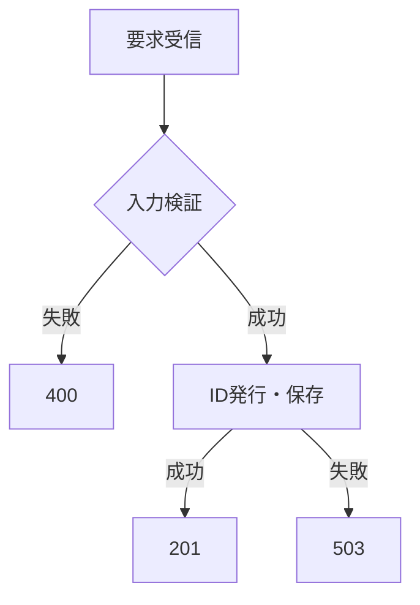

# メモ登録API v1 外部仕様書

## 1. 対象・適用範囲

対象サービス、版、提供する機能。

メモ登録API v1の外部契約を定める。タイトルと本文を受け取り、メモを保存してIDを返す。


## 2. 用語・前提

用語と動作の前提。

| 用語 | 意味 |
|---|---|
| メモ | id、title、contentからなる保存対象 |
| 呼出し元 | HTTP APIを利用するクライアント |

本文はUTF-8 JSON objectとする。


## 3. 提供インターフェース

呼出しを受ける際の要求・検証・応答。

### 3.1 接続条件

| 項目 | 仕様 |
|---|---|
| メソッド・パス | POST `/notes` |
| Content-Type | application/json（UTF-8） |

### 3.2 要求

| 項目 | 型 | 条件 |
|---|---|---|
| `title` | string | 必須。空文字は不可 |
| `content` | string | 必須。空文字可 |

```json
{"title":"買い物","content":"牛乳"}
```

### 3.3 検証

titleまたはcontentの欠落・null・型不一致、titleの空文字、JSON構文不正の場合は入力エラーとする。titleの空白だけの文字列は受理する。追加項目は無視する。

### 3.4 応答

| 条件 | HTTP | JSON本文 |
|---|---:|---|
| 保存成功 | 201 | `id`（string、UUID） |
| 入力エラー | 400 | `error`（string、固定値 `"invalid_input"`） |
| 保存失敗 | 503 | `error`（string、固定値 `"storage_unavailable"`） |

```json
{"id":"550e8400-e29b-41d4-a716-446655440000"}
```


## 4. 利用インターフェース

他のサービスを呼び出す際の要求・応答・認証。

### 4.1 接続一覧

該当なし（外部サービスへの通信契約は定めない）。

### 4.2 要求

該当なし。

### 4.3 応答

該当なし。

### 4.4 認証

該当なし。


## 5. 処理規則

インターフェース間の対応と処理順序。

### 5.1 全体フロー

外部仕様上の動作を示す概念図。



### 5.2 対象の選別

入力検証を満たす要求を保存対象とする。入力エラーの場合は保存を行わない。

### 5.3 入出力の対応

検証成功後にUUIDを発行し、id、title、contentを保存する。title・contentはデコードした文字列をそのまま保存する。応答idは保存したidと一致する。

### 5.4 応答と後続処理

保存処理を1回行い、その結果に応じてHTTP応答を返す。保存失敗時に同じ要求を自動再試行しない。


## 6. エラー・タイムアウト

異常時の結果と処理期限。

### 6.1 受付時の異常

入力エラー時はHTTP 400を返す。

### 6.2 呼出し結果の扱い

保存処理の失敗時はHTTP 503を返す。

### 6.3 期限と復帰

処理期限・クライアント切断時の外部結果は未規定。


## 7. 設定

設定項目と動作。

### 7.1 設定項目と動作

該当なし。

### 7.2 設定と通信値の区別

該当なし。


## 8. 参照資料

根拠資料と契約の適用版。

### 8.1 プロジェクト資料

本書の例は架空のサービス契約。

### 8.2 接続先の実装資料

該当なし。

### 8.3 外部公式ドキュメント

該当なし。
