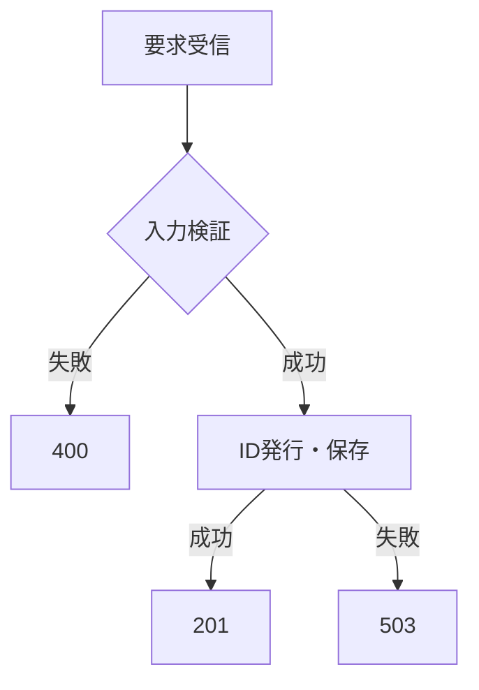

# メモ登録API v1 外部仕様書

## 1. 対象・適用範囲

メモ登録API v1の外部契約を定める。タイトルと本文を受け取り、メモを保存してIDを返す。

## 2. 用語・前提

| 用語 | 意味 |
|---|---|
| メモ | `id`、`title`、`content`からなる保存対象 |
| 呼出し元 | HTTP APIを利用するクライアント |

## 3. 提供インターフェース

### 3.1 接続条件

| 項目 | 仕様 |
|---|---|
| メソッド・パス | POST `/notes` |
| Content-Type | `application/json`（UTF-8） |
| 要求本文 | JSON object |

### 3.2 要求

| 項目 | 型 | 条件 |
|---|---|---|
| `title` | string | 必須。空文字は不可 |
| `content` | string | 必須。空文字可 |

```json
{"title":"買い物","content":"牛乳"}
```

### 3.3 検証

次のいずれかに該当する場合は入力エラーとする。

- JSON構文不正、または本文がJSON objectではない。
- `title`または`content`が[3.2](#32-要求)の条件を満たさない。

`title`の空白だけの文字列は受理する。追加項目は無視する。

### 3.4 応答

| 条件 | HTTPステータス | JSON本文 |
|---|---:|---|
| 保存成功 | 201 | `id`（string、UUID） |
| 入力エラー | 400 | `error`（string、固定値 `"invalid_input"`） |
| 保存失敗 | 503 | `error`（string、固定値 `"storage_unavailable"`） |

```json
{"id":"550e8400-e29b-41d4-a716-446655440000"}
```

## 4. 利用インターフェース

### 4.1 接続一覧

該当なし（外部サービスへの通信契約は定めない）。

### 4.2 要求

該当なし。

### 4.3 応答

該当なし。

### 4.4 認証

該当なし。

## 5. 処理規則

### 5.1 全体フロー



### 5.2 対象の選別

[3.3](#33-検証)の入力エラーに該当しない要求を保存対象とする。

### 5.3 入出力の対応

| 保存項目 | 値 |
|---|---|
| `id` | 入力検証成功後、登録ごとに発行するUUID |
| `title` | 要求の`title`をデコードした文字列 |
| `content` | 要求の`content`をデコードした文字列 |

成功応答の`id`には保存した`id`を設定する。

### 5.4 応答と後続処理

保存処理を1回行い、その結果に応じて[3.4](#34-応答)の応答を返す。

## 6. エラー・タイムアウト

### 6.1 受付時の異常

入力エラー時は[3.4](#34-応答)の入力エラー応答を返して処理を終了する。

### 6.2 呼出し結果の扱い

保存処理の失敗時は[3.4](#34-応答)の保存失敗応答を返して処理を終了する。

### 6.3 期限と復帰

処理期限・クライアント切断時の外部結果は未規定。

## 7. 設定

### 7.1 設定項目と動作

該当なし。

### 7.2 設定と通信値の区別

該当なし。

## 8. 参照資料

### 8.1 プロジェクト資料

本書の例は架空のサービス契約。

### 8.2 接続先の実装資料

該当なし。

### 8.3 外部公式ドキュメント

該当なし。
