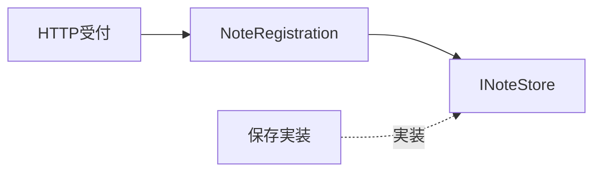

# メモ登録API v1 内部仕様書

## 1. 対象・適用範囲

内部構造を定める対象と目的。

メモ登録API v1の内部構造を定める。HTTP受付、登録、保存を分離し、保存実装を差し替えられる構成とする。

## 2. 用語・前提

用語と実装環境。

### 2.1 用語

| 用語 | 意味 |
|---|---|
| Note | 保存対象のメモ |
| INoteStore | 保存境界 |
| 登録処理 | ID発行と保存を担当 |

### 2.2 実装環境

| 項目 | 名称 | バージョン |
|---|---|---|
| 言語 | C# | 12 |
| ターゲット フレームワーク | .NET | 8.0 |
| プロジェクトSDK | Microsoft.NET.Sdk.Web | .NET 8対応 |

## 3. 構造・責務

内部構造、責務分担、依存方向。

### 3.1 全体構造

#### 3.1.1 構成図

### 3.2 責務分担

| 構成要素 | 責務 |
|---|---|
| HTTP受付 | JSON検証、登録呼出し、結果のHTTP変換 |
| NoteRegistration | UUID発行、Note生成、保存呼出し、登録結果 |
| INoteStore実装 | Noteの保存と保存結果の返却 |

### 3.3 依存方向

| 構成要素 | 利用する境界・実装 |
|---|---|
| HTTP受付 | NoteRegistration |
| NoteRegistration | INoteStore |
| 構成処理 | NoteRegistration・保存実装 |

## 4. 内部インターフェース

構成要素間の契約。

### 4.1 一覧

| 型・メソッド | 宣言 |
|---|---|
| Note | `record Note(Guid Id, string Title, string Content)` |
| INoteStore.SaveAsync | `Task<bool> SaveAsync(Note note, CancellationToken cancellationToken)` |
| NoteRegistration.RegisterAsync | `Task<RegistrationResult> RegisterAsync(string title, string content, CancellationToken cancellationToken)` |
| RegistrationResult | `record RegistrationResult(bool Saved, Guid? Id)` |

### 4.2 入力

登録処理は検証済みのtitle・contentを受け取り、生成したUUIDと共にNoteを保存境界へ渡す。取消トークンを保存境界へ引き渡す。

### 4.3 結果

保存結果trueの場合はSaved=trueかつIdは保存したUUID。falseの場合はSaved=falseかつId=null。保存失敗の通知は保存境界のfalseを用いる。HTTP受付は結果を外部契約の201または503へ変換する。

### 4.4 取消・タイムアウト・例外

取消トークンによる取消例外は呼出し元へ伝播する。その他の例外分類・処理期限は未規定。

## 5. 構成・差替え

依存解決と実装の選択。

### 5.1 依存解決

起動時に標準DIで登録する。

| 登録対象 | 生存期間 |
|---|---|
| NoteRegistration | Scoped |
| INoteStoreの実装 | Scoped |

| 処理 | スコープ | 依存解決と処理範囲 |
|---|---|---|
| HTTP受付 | HTTP要求スコープ | 要求スコープで解決する |

### 5.2 差替え

保存実装を変更する際はINoteStoreの登録を変更する。NoteRegistrationはINoteStoreをコンストラクター引数に取る。

## 6. 参照資料

根拠資料と適用版。

[外部仕様書](external-specification.md)を外部契約の根拠とする。
