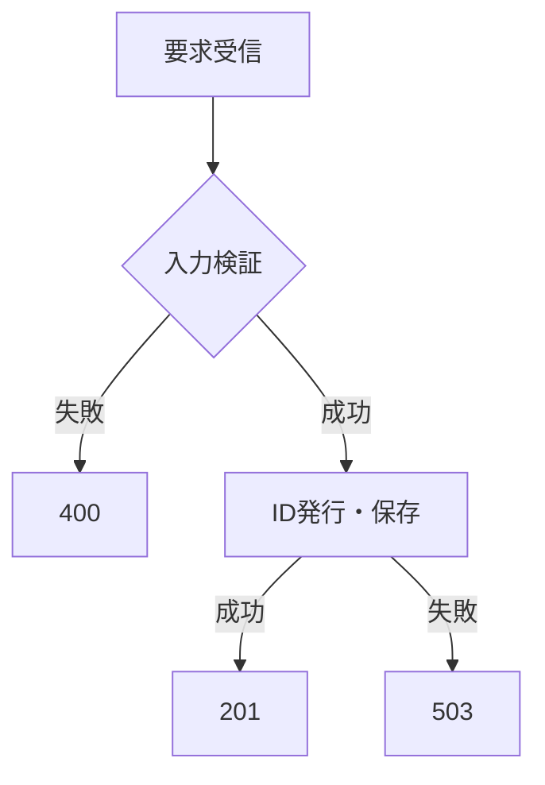
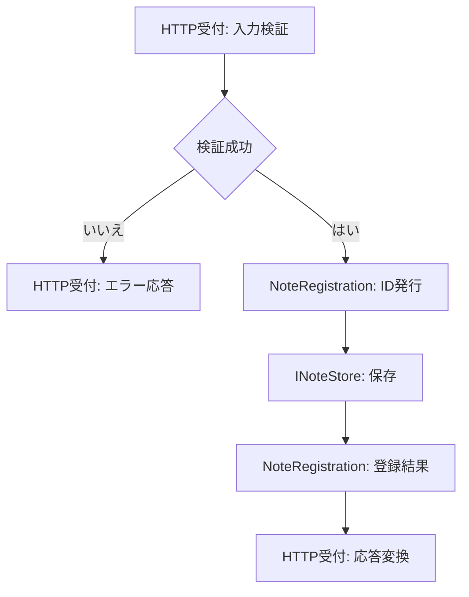
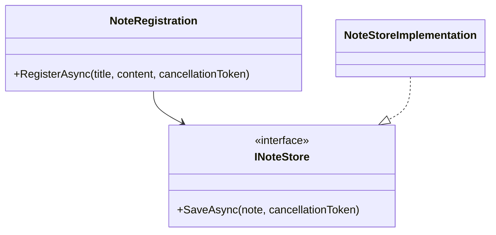

# メモ登録API v1 仕様書

## 1. 対象・適用範囲

メモ登録API v1の外部契約と内部構造を定める。タイトルと本文を受け取り、メモを保存してIDを返す。HTTP受付、登録、保存を分離する。

## 2. 用語・前提

### 2.1 用語

| 用語 | 意味 |
|---|---|
| メモ | `id`、`title`、`content`からなる保存対象 |
| 呼出し元 | HTTP APIを利用するクライアント |
| `Note` | 保存対象のメモ |
| `INoteStore` | 保存インターフェース |

### 2.2 実装環境

| 項目 | 名称 | バージョン |
|---|---|---|
| 言語 | C# | 12 |
| ターゲット フレームワーク | .NET | 8.0 |
| プロジェクトSDK | Microsoft.NET.Sdk.Web | .NET 8対応 |

## 3. 提供インターフェース

### 3.1 接続条件

| 項目 | 仕様 |
|---|---|
| メソッド・パス | POST `/notes` |
| Content-Type | `application/json`（UTF-8） |
| 要求本文 | JSON object |

### 3.2 要求

| 項目 | 型 | 条件 |
|---|---|---|
| `title` | string | 必須。空文字は不可 |
| `content` | string | 必須。空文字可 |

```json
{"title":"買い物","content":"牛乳"}
```

### 3.3 検証

次のいずれかに該当する場合は入力エラーとする。

- JSON構文不正、または本文がJSON objectではない。
- `title`または`content`が[3.2](#32-要求)の条件を満たさない。

`title`の空白だけの文字列は受理する。追加項目は無視する。

### 3.4 応答

| 条件 | HTTPステータス | JSON本文 |
|---|---:|---|
| 保存成功 | 201 | `id`（string、UUID） |
| 入力エラー | 400 | `error`（string、固定値 `"invalid_input"`） |
| 保存失敗 | 503 | `error`（string、固定値 `"storage_unavailable"`） |

```json
{"id":"550e8400-e29b-41d4-a716-446655440000"}
```

## 4. 利用インターフェース

### 4.1 接続一覧

該当なし（外部サービスへの通信契約は定めない）。

### 4.2 要求

該当なし。

### 4.3 応答

該当なし。

### 4.4 認証

該当なし。

## 5. 処理規則

### 5.1 全体フロー



### 5.2 対象の選別

[3.3](#33-検証)の入力エラーに該当しない要求を保存対象とする。

### 5.3 入出力の対応

| 保存項目 | 値 |
|---|---|
| `id` | 入力検証成功後、登録ごとに発行するUUID |
| `title` | 要求の`title`をデコードした文字列 |
| `content` | 要求の`content`をデコードした文字列 |

成功応答の`id`には保存した`id`を設定する。

### 5.4 応答と後続処理

保存処理を1回行い、その結果に応じて[3.4](#34-応答)の応答を返す。

## 6. エラー・タイムアウト

### 6.1 受付時の異常

入力エラー時は[3.4](#34-応答)の入力エラー応答を返して処理を終了する。

### 6.2 呼出し結果の扱い

保存処理の失敗時は[3.4](#34-応答)の保存失敗応答を返して処理を終了する。

### 6.3 期限と復帰

処理期限・クライアント切断時の外部結果は未規定。

## 7. 設定

### 7.1 設定項目と動作

該当なし。

### 7.2 設定と通信値の区別

該当なし。

## 8. 構造・責務

### 8.1 全体構造

#### 8.1.1 処理フロー



#### 8.1.2 クラス図



`NoteStoreImplementation`は選択される保存実装を表す図上の名称。

### 8.2 責務分担

| 構成要素 | 責務 |
|---|---|
| HTTP受付 | JSON検証、登録呼出し、結果のHTTP変換 |
| `NoteRegistration` | UUID発行、`Note`生成、保存呼出し、登録結果の生成 |
| `INoteStore`の実装 | `Note`の保存と保存結果の返却 |

### 8.3 依存方向

| 構成要素 | 利用する境界・実装 |
|---|---|
| HTTP受付 | `NoteRegistration` |
| `NoteRegistration` | `INoteStore` |
| 構成処理 | `NoteRegistration`、選択した保存実装 |

## 9. 内部インターフェース

### 9.1 一覧

| 境界 | 呼出し元 | 操作 | 実装・生成 |
|---|---|---|---|
| `NoteRegistration` | HTTP受付 | `RegisterAsync` | DIで解決 |
| `INoteStore` | `NoteRegistration` | `SaveAsync` | DIで解決した保存実装 |

**宣言**

| 型・メソッド | 宣言 |
|---|---|
| `Note` | `record Note(Guid Id, string Title, string Content)` |
| `INoteStore.SaveAsync` | `Task<bool> SaveAsync(Note note, CancellationToken cancellationToken)` |
| `NoteRegistration.RegisterAsync` | `Task<RegistrationResult> RegisterAsync(string title, string content, CancellationToken cancellationToken)` |
| `RegistrationResult` | `record RegistrationResult(bool Saved, Guid? Id)` |

### 9.2 入力

#### 9.2.1 登録処理

| 引数 | 型 | 意味 |
|---|---|---|
| `title` | string | 検証済みのタイトル |
| `content` | string | 検証済みの本文 |
| `cancellationToken` | CancellationToken | HTTP受付から渡す取消トークン |

#### 9.2.2 保存境界

| `Note`のプロパティ | 型 | 渡す値 |
|---|---|---|
| `Id` | Guid | 登録処理が発行したUUID |
| `Title` | string | 登録処理の引数`title` |
| `Content` | string | 登録処理の引数`content` |

保存境界の引数`cancellationToken`には、登録処理が受け取った取消トークンを渡す。

### 9.3 結果

| `INoteStore.SaveAsync`の結果 | `RegistrationResult.Saved` | `RegistrationResult.Id` |
|---|---|---|
| `true`（保存成功） | `true` | 保存した`Note.Id` |
| `false`（保存失敗） | `false` | `null` |

HTTP受付は登録結果を[3.4](#34-応答)の保存成功または保存失敗の応答へ変換する。

### 9.4 取消・タイムアウト・例外

取消トークンによる取消例外は呼出し元へ伝播する。その他の例外分類・処理期限は未規定。

## 10. 構成・差替え

### 10.1 依存解決

**DI登録**

| 登録対象 | 生存期間 |
|---|---|
| `NoteRegistration` | Scoped |
| `INoteStore`の実装 | Scoped |

**スコープ**

| 処理 | スコープ | 依存解決と処理範囲 |
|---|---|---|
| HTTP受付 | HTTP要求スコープ | 要求ごとに登録処理と保存実装を解決する |

DI登録はアプリケーション起動時に行う。

### 10.2 差替え

| 対象 | 差替えの契約 |
|---|---|
| 保存実装 | `INoteStore`のDI登録を変更する |

`NoteRegistration`は`INoteStore`をコンストラクター引数に取る。

## 11. 参照資料

### 11.1 プロジェクト資料

本書の例は架空のサービス契約。

### 11.2 接続先の実装資料

該当なし。

### 11.3 外部公式ドキュメント

該当なし。
