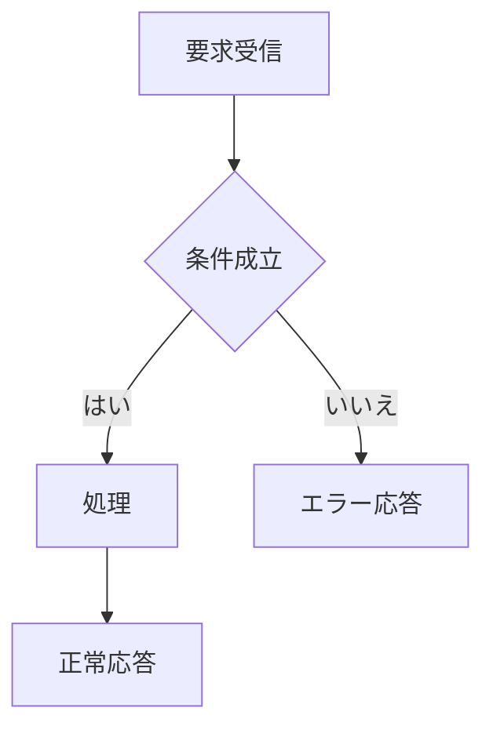

# Markdownの記述方法

## 1. 見出し

文書名をH1、章をH2、節をH3、対象固有の下位区分をH4以降に置く。番号と題名は同種の文書で揃える。章冒頭の共通文は必要に応じてその章の役割を示す。

## 2. 表と箇条書き

同じ観点で複数の項目を比較するなら表を使う。要求・応答の型と値、設定、条件別の動作、依存関係、試験条件は表に適する。順序を持つ操作は番号付きリスト、順序を持たない項目は箇条書きとする。

| 項目 | 型 | 値・条件 |
|---|---|---|
| `message` | object | メッセージ |
| `message.content` | object[] | 1件以上 |
| `message.content[].text` | string | 各要素の本文 |

一般的な型表記を使い、固定文字列・キー・パス・型名はインラインコードで示す。独自表記が必要な場合は説明する。

### 2.1 図表と説明文

図表に記載できる情報は図表に記載する。

図表の前後に説明文を作成する場合は、以下を確認する。

- その文章を削除すると、仕様の理解や実装に必要な情報が失われるか。
- その情報を図表の項目、タイトル、注記として記載できないか。
- 他の箇所に同じ情報が既に記載されていないか。

図表や既存の記述で情報を伝えられる場合は、説明文を省略する。

図表のタイトルは対象が分かる簡潔な名称とする。章・節のタイトルが図表のタイトルを兼ねる場合は省略する。

## 3. 図

フロー図、クラス図、構成図にはMermaidを利用できる。図と仕様本文の条件・順序・依存を一致させる。外部の概念フローに内部クラスの対応を求めない。図から未規定の処理を新たに要求しない。

## 4. 参照リンク

同一文書内の参照は章番号だけをリンクにする例：[2章](#2-表と箇条書き)。複数の仕様書の参照では文書名も特定する。番号を変える可能性が高いケースID等には明示的なアンカーも使える。外部資料の発行元、タイトル、採用箇所、確認版を示し、更新されるコード・契約は必要に応じcommitや版を固定する。

## 5. 改善前後の例

| 改善前 | 改善後 |
|---|---|
| 要求が不正なら処理しない | titleが空文字の場合、HTTP 400を返し、保存処理を呼ばない |
| 適切なIDを生成する | 入力検証成功後にUUIDを発行し、保存データと応答のidに同じ値を用いる |
| ホストを起動する | 試験用ホストとして本番エントリーポイントを起動する |
| 正常に返信できること | HTTP 201、JSONのidが保存時のidと一致すること |
| 下記の表の通りとなる | 節タイトルと表で直接記載する |

改善は実際の契約に基づいて行う。曖昧な旧文から新しい条件を推測して確定しない。
