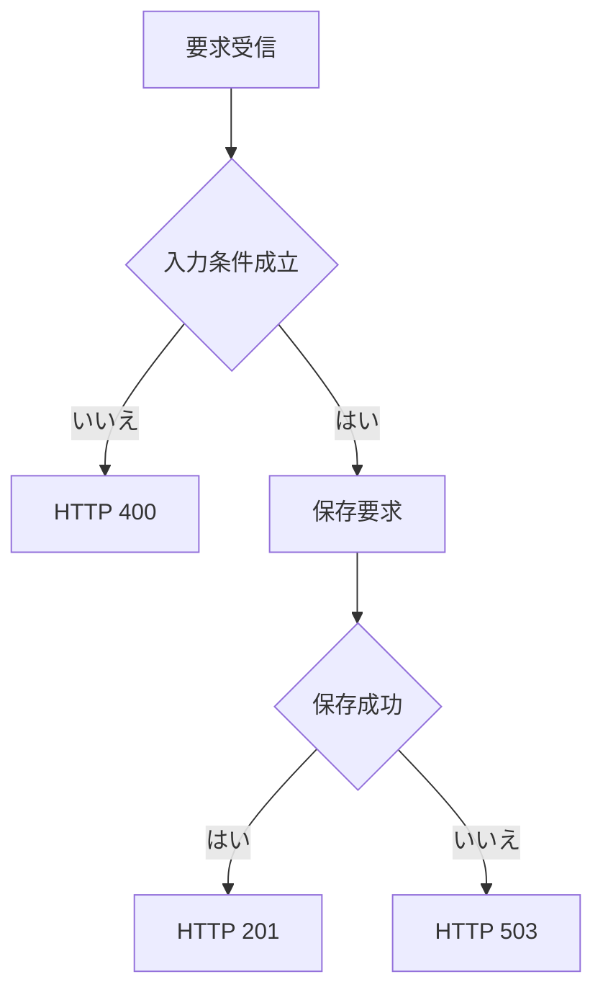
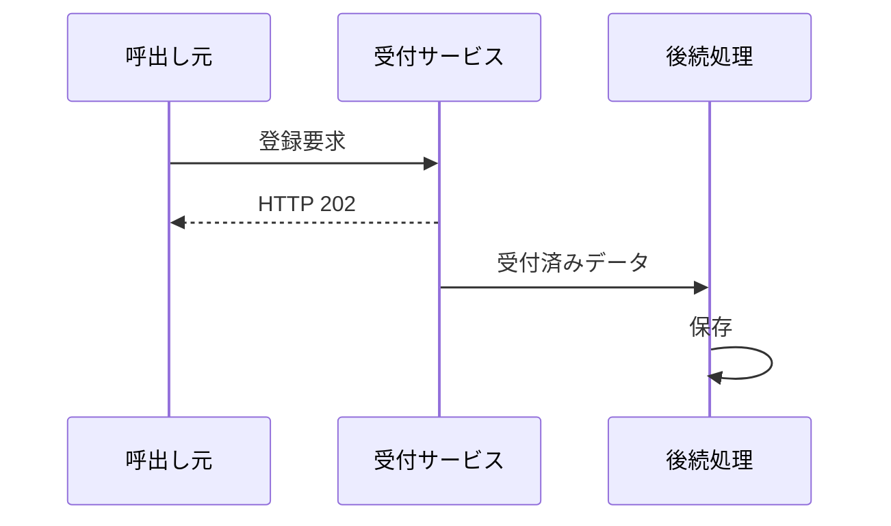
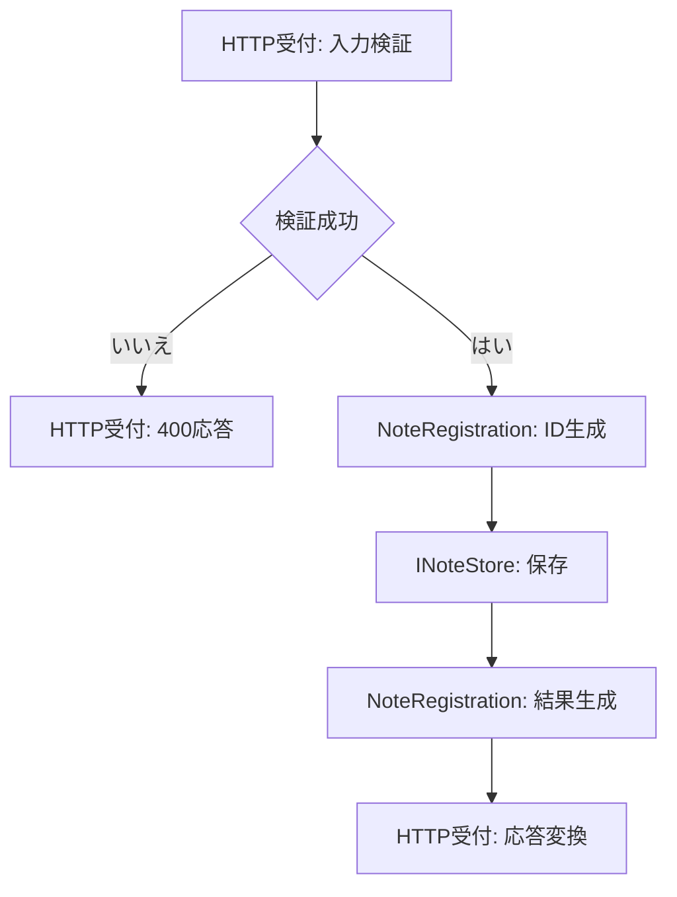
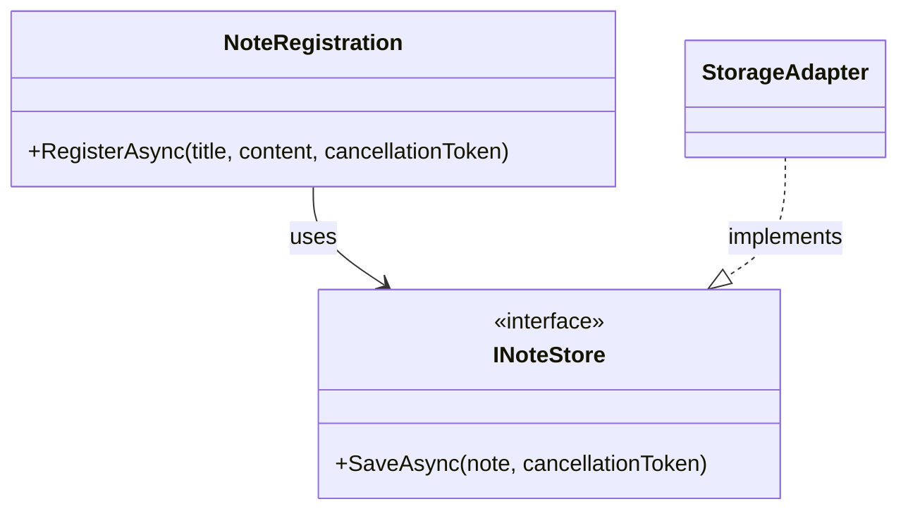
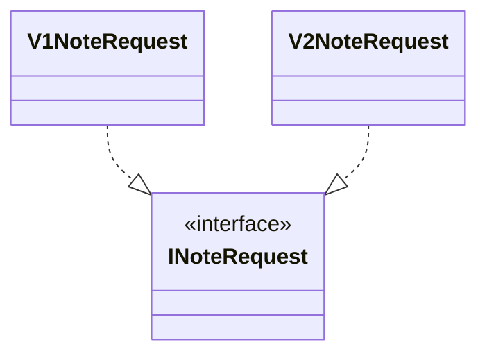

# 図の記述例

Mermaidを使った独立した記述例。対象仕様に存在する契約・構造を図にする。図表と説明文の扱いは[Markdownの記述方法](../markdown-style.md#21-図表と説明文)に従う。

## 1. 外部仕様の概念フロー

外部から観測できる分岐、要求と応答、同期・非同期の関係を表す。内部クラスや詳細な実装手順を図に持ち込まない。



非同期の受付と処理を区別する例：



この図は応答後に後続処理へ渡す契約を採用した例。応答と後続処理の順序が未規定の場合はこの順序を要求しない。

## 2. 内部仕様の処理フロー

構成要素間の処理順序と受渡しを示す。詳細な型や引数は内部インターフェースの表に置く。



## 3. クラス図

採用済みの構成要素、必要な操作、依存方向を示す。構成全体を実装するための全クラスや補助メソッドを列挙する必要はない。

**登録処理**



**版別構成**



内部仕様の全体構造を複数図で示す場合の見出し例：

```markdown
### 3.1 全体構造

#### 3.1.1 処理フロー

［Mermaidフロー図］

#### 3.1.2 クラス図

**登録処理**

［Mermaidクラス図］

**版別構成**

［Mermaidクラス図］
```

節タイトルが図題を兼ねる場合は図題を省略する。同種の図が複数ある場合は「登録処理」「版別構成」など、対象が分かる簡潔な図題にする。図の意味や依存方向が本文と一致することを確認する。
