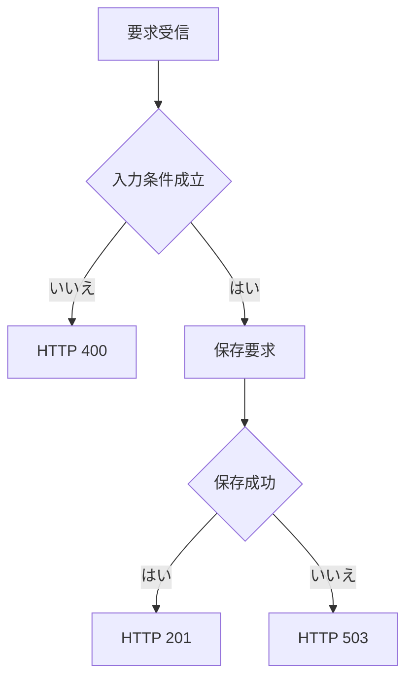
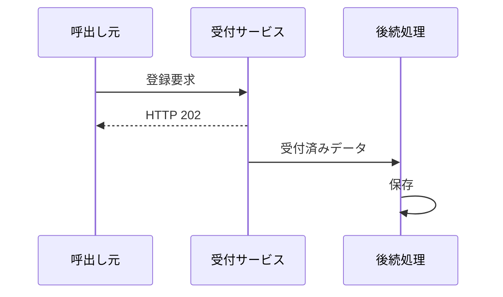
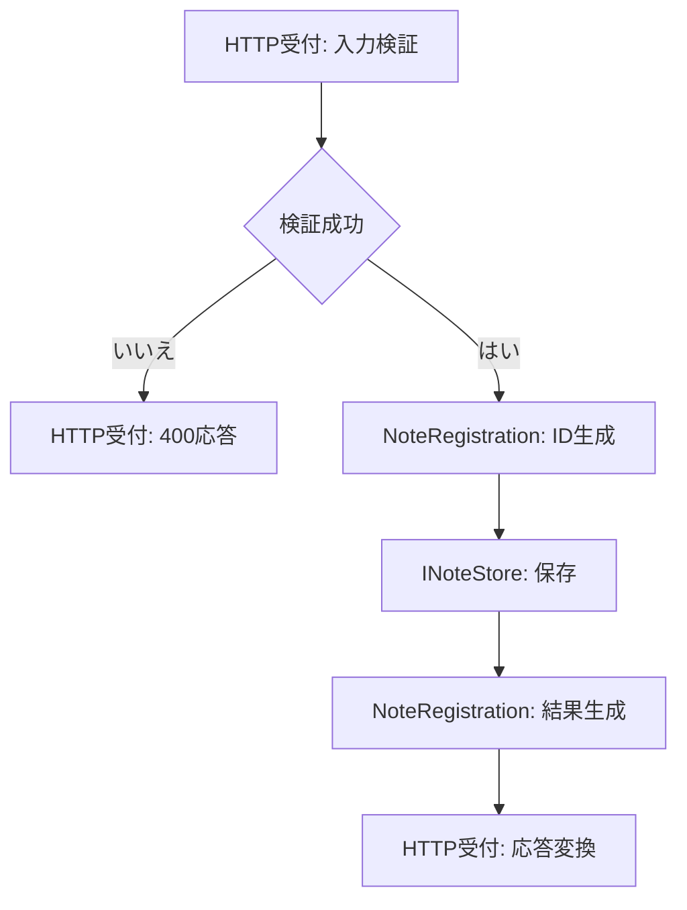
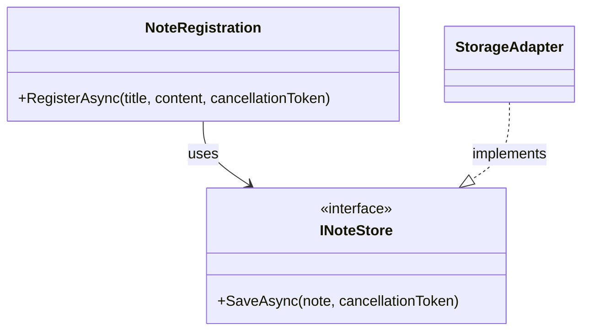
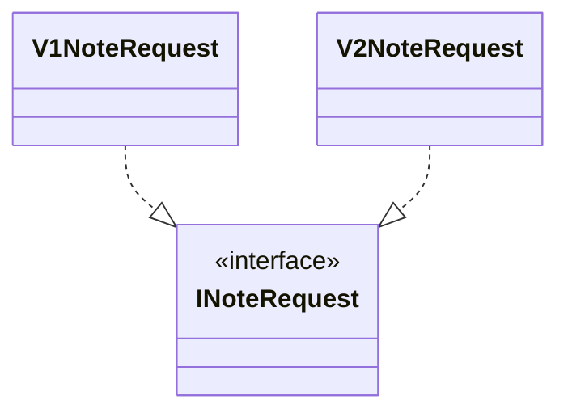

# 図の記述例

Mermaidを使った独立した記述例。対象仕様に存在する契約・構造を図にする。図表と説明文の扱いは[Markdownの記述方法](../markdown-style.md#21-図表と説明文)に従う。

## 1. 外部仕様の概念フロー

### 1.1 同期処理



### 1.2 非同期処理



応答後に後続処理へ渡す契約の例。順序が未規定なら図でも順序を確定しない。

## 2. 内部仕様の処理フロー



## 3. クラス図

**登録処理**



**版別構成**



## 4. 複数の図を配置する場合の見出し

```markdown
### 3.1 全体構造

#### 3.1.1 処理フロー

［Mermaidフロー図］

#### 3.1.2 クラス図

**登録処理**

［Mermaidクラス図］

**版別構成**

［Mermaidクラス図］
```

節タイトルが図題を兼ねる場合は図題を省略する。同種の図が複数ある場合は「登録処理」「版別構成」など、対象が分かる簡潔な図題にする。図の意味や依存方向が本文と一致することを確認する。
